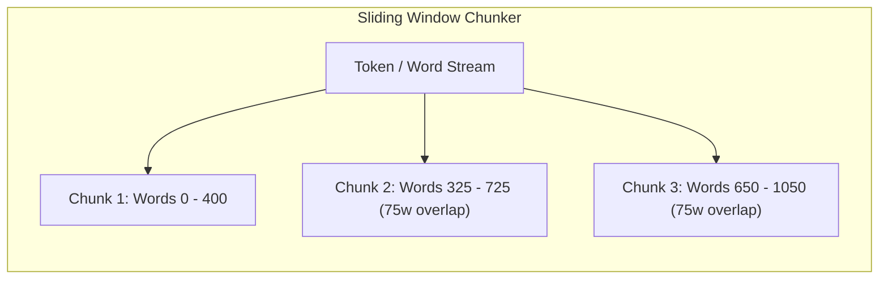
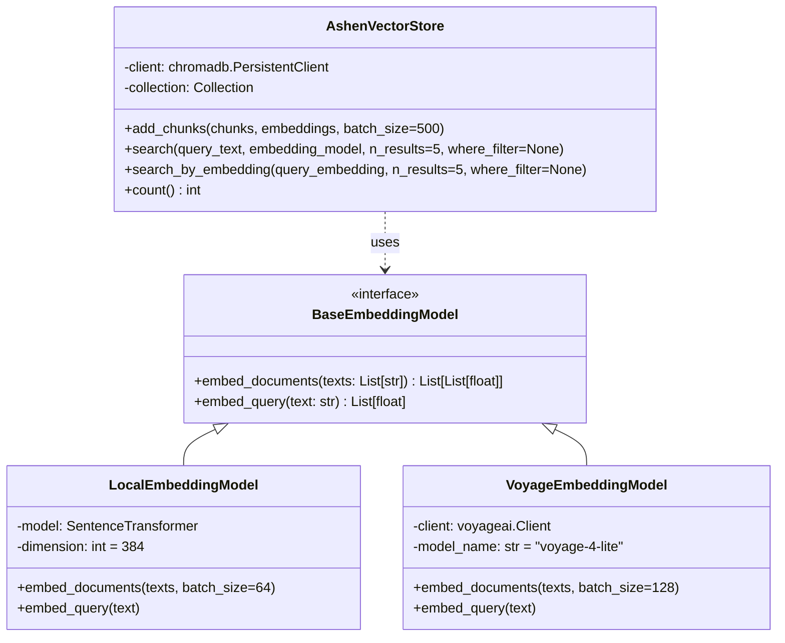
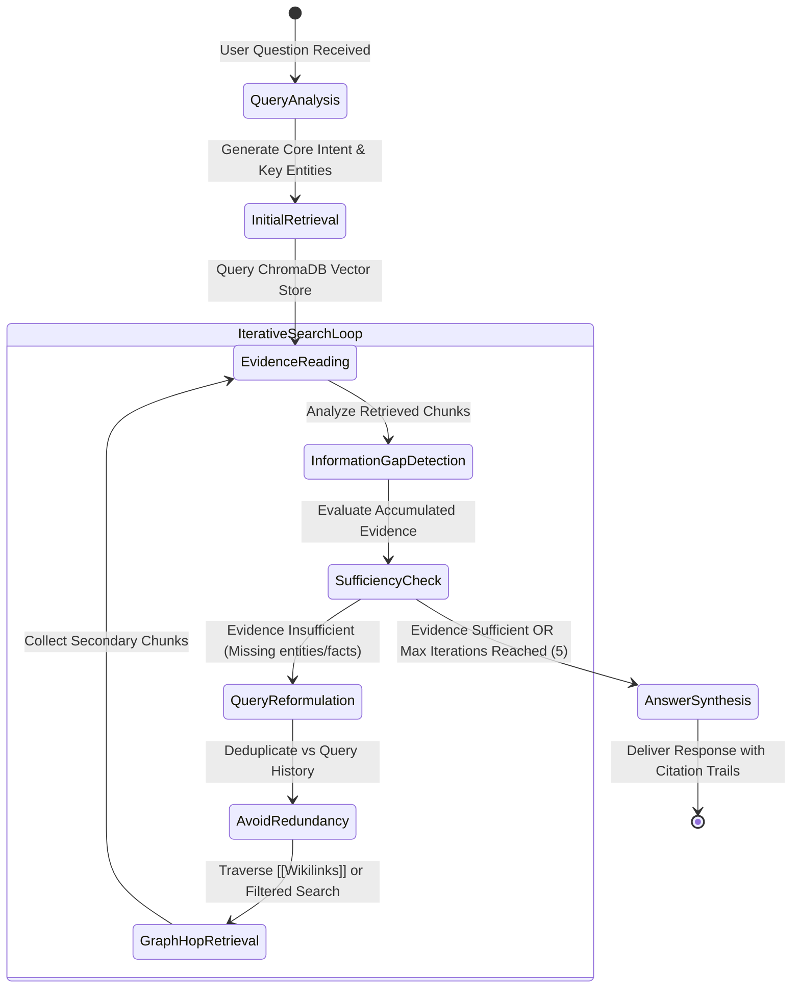

# Architecture Specification — Code-Wave Document Assistant

**System:** Ashen Era Archive Intelligent Document Assistant  
**Competition:** SLIIT Codefest 2026 — AI Competition  
**Challenge Sub-track:** Sub-track 1C — *Searching the Way a Human Does*  
**Document Path:** `docs/architecture.md`  
**Status:** 100% Implemented & Benchmark Validated (Sub-track 1C Agent, Hybrid Retrieval, OpenRouter LLM, Caching)  

---

## 1. Executive Summary & Architectural Vision

The **Code-Wave** system is an intelligent document retrieval and reasoning assistant purpose-built for the **Ashen Era Archive**—a complex, heterogeneous corpus consisting of multi-chapter chronicles, encyclopedia/wiki articles, technical codices, historical ephemera, and standalone plates.

### Core Problem
Traditional Retrieval-Augmented Generation (RAG) architectures operate in a **single-shot** fashion:
$$\text{Query} \longrightarrow \text{Vector Retrieval} \longrightarrow \text{Single LLM Context Window} \longrightarrow \text{Answer}$$

This naive approach consistently fails across complex corpora like the Ashen Era Archive due to:
1. **Multi-hop dependencies:** Information needed to answer a query is distributed across separate documents (e.g., an entity referenced in a chronicle, detailed in a wiki, and quantified in a codex plate).
2. **Embedded visual/tabular data:** Critical metrics (e.g., garrison strengths, faction rosters, plate numbers) are embedded in raster images and figures rather than machine-readable text.
3. **Lack of query evolution:** Human experts do not read a corpus once; they explore, formulate hypotheses, encounter missing evidence, follow citations/cross-references, and iteratively refine their search until sufficient proof is gathered.

### Architecture Purpose
Code-Wave establishes a **multi-tiered architecture** engineered to bridge this gap:
* **Implemented Foundation:** An end-to-end data preparation, OCR-augmented extraction, domain-specialized enrichment, chapter-aware chunking, dense vector embedding, and persistent indexing pipeline.
* **Track 1C Iterative Agent Layer:** An autonomous multi-step reasoning and retrieval state machine designed to emulate human expert research workflows.

---

## 2. High-Level System Architecture

The following diagram illustrates the complete architectural blueprint of the Code-Wave platform, spanning both the completed ingestion/vector indexing pipeline and the iterative agent search loop.

```mermaid
flowchart TD
    subgraph S1["1. Multi-Format Ingestion Layer (src/ingest/loaders.py, src/run_ingest.py)"]
        RawCorpus["Raw Archive Corpus\n(data/corpus/)"]
        Dedupe["Deduplication Engine\n(PDF preferred over DOCX)"]
        Dispatcher{"load_file() Extension Dispatcher"}
        PDFLoader["load_pdf()\nPyMuPDF (fitz)"]
        DOCXLoader["load_docx()\npython-docx"]
        MDLoader["load_markdown()\nUTF-8 Reader"]
        ImgLoader["load_image()\nPillow + Tesseract"]
        OCRFallback{"Char count < 30?"}
        PageOCR["ocr_pdf_page()\n200 DPI Raster + Tesseract"]

        RawCorpus --> Dedupe --> Dispatcher
        Dispatcher -->|".pdf"| PDFLoader
        Dispatcher -->|".docx"| DOCXLoader
        Dispatcher -->|".md / .txt"| MDLoader
        Dispatcher -->|".png / .jpg"| ImgLoader
        PDFLoader --> OCRFallback
        OCRFallback -->|"Yes (Scanned)"| PageOCR
        OCRFallback -->|"No (Selectable)"| StandardPages["Standardized Page Dicts"]
        PageOCR --> StandardPages
        DOCXLoader --> StandardPages
        MDLoader --> StandardPages
        ImgLoader --> StandardPages
    end

    subgraph S2["2. Domain-Specialized Enrichment (src/ingest/processors/)"]
        StandardPages --> ProcessDispatcher{"source_type folder"}
        WikiProc["Wiki Processor (wiki.py)\n• Extract [[Wikilinks]]\n• Parse Infobox Table\n• Extract # Heading Title"]
        CodexProc["Codex Processor (codex.py)\n• Extract Embedded Plate Images\n• OCR Plate Graphics\n• Score OCR Confidence (>60%)\n• Validate Digit Presence\n• Inject [FIGURE PLATE TEXT]"]
        PassThrough["Direct Pass-through\n(chronicles, ephemera, images)"]

        ProcessDispatcher -->|"wiki"| WikiProc
        ProcessDispatcher -->|"codex"| CodexProc
        ProcessDispatcher -->|"others"| PassThrough

        WikiProc --> ExtractedJSON["Extracted Corpus JSON\n(data/extracted/*.json)"]
        CodexProc --> ExtractedJSON
        PassThrough --> ExtractedJSON
    end

    subgraph S3["3. Structural Chunking & Embedding (src/ingest/chunk.py, src/ingest/embeddings.py)"]
        ExtractedJSON --> ChunkerDispatcher{"Document Type?"}
        ChronicleChunker["chunk_chronicles_by_chapter()\n• Regex Chapter Grouping\n• Multi-page context stitching\n• 400w chunks / 75w overlap"]
        StandardChunker["chunk_pages()\n• Sliding window 400w / 75w\n• Page-level metadata preservation"]
        
        ChunkerDispatcher -->|"chronicles"| ChronicleChunker
        ChunkerDispatcher -->|"wiki/codex/ephemera"| StandardChunker

        ChronicleChunker --> ChunksFile["Chunks Serialization\n(data/extracted/chunks.json)\nDeterministic MD5 Chunk IDs"]
        StandardChunker --> ChunksFile

        ChunksFile --> EmbedFactory["get_embedding_model()"]
        EmbedFactory -->|"Local (Default)"| MiniLM["SentenceTransformers\nall-MiniLM-L6-v2 (384-d)"]
        EmbedFactory -->|"Cloud"| VoyageAI["Voyage AI API\nvoyage-4-lite (Batch retry)"]
    end

    subgraph S4["4. Persistent Vector Indexing (src/db/vector_store.py)"]
        MiniLM --> ChromaUpsert["AshenVectorStore.add_chunks()\nBatch size: 500\nCosine Space (hnsw:space)"]
        VoyageAI --> ChromaUpsert
        ChromaUpsert --> ChromaDB[("ChromaDB Persistent Storage\n(data/vector_store/)")]
    end

    subgraph S5["5. Query & Track 1C Iterative Agent Loop"]
        UserQuery["User Research Question"] --> QueryDecomp["1. Query Analysis & Intent Decomposition"]
        QueryDecomp --> InitialSearch["2. Initial Vector Search (ChromaDB)"]
        ChromaDB -.-> InitialSearch
        InitialSearch --> Reasoner["3. Evidence Analysis & Entity Extraction\n• Cross-reference [[Wikilinks]]\n• Check Figure Plate Metrics"]
        Reasoner --> Sufficiency{"4. Is Evidence Sufficient?"}
        Sufficiency -->|"No (Missing Info)"| GapDetector["5. Gap Identifier & Query Reformulator\n• Formulate targeted next-hop query\n• Exclude already visited chunks"]
        GapDetector --> NextHopSearch["6. Iterative Secondary Retrieval"]
        NextHopSearch -.-> ChromaDB
        NextHopSearch --> EvidenceAccumulator["7. Evidence Memory & Hop Tracker"]
        EvidenceAccumulator --> Reasoner
        Sufficiency -->|"Yes or Max Hops (5)"| AnswerGen["8. Grounded Synthesis & Citation Generation"]
        AnswerGen --> FinalResponse["Final Answer with Source Traceability"]
    end
```



---

## 3. Subsystem Breakdown

### 3.1 Document Ingestion & Extraction Layer

Located in [`src/ingest/loaders.py`](file:///d:/Projects/Code%20Wave/Code-Wave/src/ingest/loaders.py) and orchestrated by [`src/run_ingest.py`](file:///d:/Projects/Code%20Wave/Code-Wave/src/run_ingest.py).

#### Standardized Page Representation
To eliminate format disparities across heterogeneous files, every loader converts input documents into a uniform schema:
```python
{
    "text": str,          # Clean extracted or OCR-processed text
    "source_file": str,   # Path to original archive file
    "source_type": str,   # Archive folder ('chronicles' | 'wiki' | 'codex' | 'ephemera' | 'images')
    "page": int | None,   # 1-indexed page number (or None for single-stream docs)
    "has_ocr": bool,      # True if Tesseract OCR was invoked
    "title": str | None   # Document or plate title if available
}
```

#### Multi-Format Loaders
1. **PDF Loader (`load_pdf`)**:
   - Utilizes `pymupdf` (`fitz`) for fast, high-fidelity text extraction.
   - **Automated Scanned Document Fallback:** Scanned documents (such as `.scan.pdf` in ephemera) often yield little to no selectable text. If `len(text) < 30` characters, the loader dynamically triggers full-page OCR via `ocr_pdf_page()`.
2. **DOCX Loader (`load_docx`)**:
   - Uses `python-docx` to extract paragraph streams joined by newlines.
3. **Markdown / Text Loader (`load_markdown`)**:
   - Ingests raw `.md` and `.txt` files with UTF-8 encoding (ignoring corrupted byte sequences).
4. **Image Loader (`load_image`)**:
   - Loads standalone `.png`, `.jpg`, and `.jpeg` files.
   - Generates titles from sanitized filenames and executes OCR via Tesseract.

#### File Deduplication Strategy (`dedupe_by_basename`)
The archive contains duplicate copies of identical books formatted in both `.pdf` and `.docx`. If left unaddressed, this causes duplicate vector embeddings that pollute retrieval ranking.
- The pipeline groups candidate files by stem name (`f.stem.lower()`).
- **Precedence Rule:** If both formats exist, the `.pdf` version is strictly retained and the `.docx` is discarded, as PDF preserves precise page numbers necessary for citation and chapter tracking.

---

### 3.2 Domain-Specialized Document Processors

Located in [`src/ingest/processors/`](file:///d:/Projects/Code%20Wave/Code-Wave/src/ingest/processors/).

```
src/ingest/processors/
├── ocr.py       # Full-page rasterization and OCR engine
├── codex.py     # Figure plate extraction, numeric verification & text injection
└── wiki.py      # Wikilink graph extraction & infobox parser
```

#### A. Codex Figure Plate Processor (`codex.py`)
Codex documents present a unique multimodal challenge: prose is selectable text, but vital metrics (e.g., garrison headcounts, troop allocations) are embedded inside graphical gauge/plate diagrams.
* **Extraction:** Inspects embedded image blocks (`page.get_images()`) per PDF page using `PyMuPDF`.
* **Plate OCR:** Crops and converts images in memory using Pillow, piping them to Tesseract.
* **Quality Assurance & Confidence Scoring:**
  - Standard average confidence is misleading when Tesseract misinterprets graphic lines as characters.
  - The processor inspects word-level confidence: if minimum word confidence $< 60\%$ or if no numerical digits are found in the output, it flags `low_confidence=True` and `plate_needs_review=True`.
* **Content Injection:** Merged into the page text under a designated marker:
  ```text
  [FIGURE PLATE TEXT]
  Plate - Greyfell Citadel:
  RECORDED GARRISON STRENGTH: 3,695
  ```

#### B. Wiki Processor (`wiki.py`)
Wiki articles represent an explicit knowledge graph of the archive:
* **Wikilink Parsing (`extract_wikilinks`)**: Identifies all `[[Entity Name]]` references using regular expressions. In Track 1C multi-hop search, these extracted entities serve as candidate nodes for subsequent search hops.
* **Infobox Extraction (`extract_infobox`)**: Extracts markdown tables matching the `| Field | Value |` pattern into clean key-value dictionaries, stripping syntax markers for clean retrieval.
* **Title Extraction (`extract_title`)**: Extracts primary subject headings from `# Heading` lines.

#### C. Full-Page OCR Processor (`ocr.py`)
* Renders unselectable PDF pages to high-resolution pixmaps at 200 DPI (`fitz.Matrix(200/72, 200/72)`).
* Transcribes images via `pytesseract.image_to_string()`.

---

### 3.3 Chunking & Serialization Subsystem

Located in [`src/ingest/chunk.py`](file:///d:/Projects/Code%20Wave/Code-Wave/src/ingest/chunk.py).

#### Chunking Strategies


1. **Standard Page Chunking (`chunk_pages`)**:
   - Applies word-count sliding window segmentation (`chunk_size=400` words, `overlap=75` words $\approx 500$ tokens).
   - Preserves all source-level metadata fields (`page`, `source_type`, `has_plate`, `has_ocr`).
2. **Chapter-Aware Chronicle Chunking (`chunk_chronicles_by_chapter`)**:
   - Chronicles narrate historical events spanning dozens of pages. Page boundaries disrupt narrative coherence.
   - Detects chapter headers via regex (`CHAPTER_PATTERN = re.compile(r"^\s*(Chapter\s+[\dIVXLCM]+|CHAPTER\s+[\dIVXLCM]+|Chapter\s+\w+)\b.*$")`).
   - Merges pages belonging to the same chapter, prefixes every chunk with `[Chapter: <Title>]`, and tracks start/end page spans.

#### Deterministic Chunk Identification
To ensure idempotent database updates and consistent cross-referencing:
$$\text{chunk\_id} = \text{clean\_stem} + \text{"\_c"} + \text{index}_{03d} + \text{"\_"} + \text{MD5}(\text{source\_file} + \text{"\_"} + \text{index})[:6]$$
*Example:* `chronicles_vol1_c014_9a8f2c`

---

### 3.4 Embedding & Vector Database Subsystem

Located in [`src/ingest/embeddings.py`](file:///d:/Projects/Code%20Wave/Code-Wave/src/ingest/embeddings.py) and [`src/db/vector_store.py`](file:///d:/Projects/Code%20Wave/Code-Wave/src/db/vector_store.py).



#### Dual Embedding Provider Architecture
* **Local Provider (`LocalEmbeddingModel`)**:
  - Model: `sentence-transformers/all-MiniLM-L6-v2`
  - Output Dimension: 384
  - Advantage: Fully offline execution, zero external API costs, deterministic reproducibility.
* **Remote Provider (`VoyageEmbeddingModel`)**:
  - Model: `voyage-4-lite` via Voyage AI
  - Batching & Fault Tolerance: Implements exponential backoff retry logic (up to 5 retries, $t_{\text{wait}} = 2^{\text{retry}}$ seconds) to handle rate limiting.

#### Persistent Vector Database (`AshenVectorStore`)
* **Underlying Engine:** ChromaDB (`PersistentClient` stored at `data/vector_store/`).
* **Metric Space:** Cosine distance (`{"hnsw:space": "cosine"}`).
* **Similarity Score Normalization:**
  $$\text{Score} = \begin{cases} 1.0 - \text{distance} & \text{if } \text{distance} \le 1.0 \\ \frac{1.0}{1.0 + \text{distance}} & \text{otherwise} \end{cases}$$
* **Batch Upsert:** Chunks are ingested in batches of 500 records to prevent memory exhaustion during full-corpus ingestion.
* **Filtered Searches:** Native metadata filtering (`where_filter`) allows querying subsets by `source_type`, `has_plate`, or `chapter`.

---

## 4. Sub-track 1C: Human-Like Iterative Search Agent Architecture

Sub-track 1C requires systems to exhibit **adaptive, multi-step search behaviour** rather than single-shot retrieval. Below is the architectural design for the query-time reasoning agent that builds directly on Code-Wave's enriched data foundation.



### Human-Like Search Stages

| Stage | Agent Responsibility | Mechanism in Code-Wave |
|---|---|---|
| **1. Intent Decomposition** | Break compound questions into search goals | LLM reasoning prompt extracts focal entities and required attributes |
| **2. Initial Retrieval** | Retrieve foundational context | Cosine similarity query against ChromaDB collection |
| **3. Evidence Reading & Analysis** | Extract facts, identify referenced entities | Scan retrieved chunks for structured facts, infobox values, and plate markers |
| **4. Gap Detection** | Determine what information remains unresolved | Compare collected facts against initial query goals |
| **5. Query Reformulation** | Formulate follow-up search queries | Select candidate terms from extracted `[[wikilinks]]` or specific entity-attribute pairs |
| **6. Loop & Redundancy Prevention** | Prevent infinite search loops | Maintain visited query log $\mathcal{Q}_{\text{history}}$ and chunk ID set $\mathcal{C}_{\text{seen}}$ |
| **7. Sufficiency Evaluation** | Decide whether to stop or continue | Evaluator checks confidence score and completeness threshold; hard bound at 5 iterations |
| **8. Answer Synthesis** | Generate final answer with traceability | Synthesize grounded prose citing `source_file`, `page`, and `chapter` |

---

## 5. Diagnostic, Quality Assurance & Tooling Layer

Code-Wave incorporates a suite of diagnostic tools developed during pipeline implementation to ensure extraction integrity across edge cases:

| Tool | Path | Architectural Purpose |
|---|---|---|
| **Extraction Gap Checker** | [`src/check_extraction.py`](file:///d:/Projects/Code%20Wave/Code-Wave/src/check_extraction.py) | Scans all extracted JSON files for near-empty pages ($< 50$ chars) and writes flags to `_needs_ocr.json`. |
| **Codex Plate Auditor** | [`src/check_plates.py`](file:///d:/Projects/Code%20Wave/Code-Wave/src/check_plates.py) | Audits codex pages where `plate_needs_review=True` due to low OCR confidence or missing digits. |
| **Flagged Page Inspector** | [`src/inspect_flagged.py`](file:///d:/Projects/Code%20Wave/Code-Wave/src/inspect_flagged.py) | Pretty-prints the complete text of flagged pages for developer inspection. |
| **Gazetteer Spot-Checker** | [`src/spot_check_emberdeep.py`](file:///d:/Projects/Code%20Wave/Code-Wave/src/spot_check_emberdeep.py) | Performs targeted verification of specific gazetteer entities (e.g., "Emberdeep") to confirm OCR capture. |
| **Chapter Grouping Tool** | [`src/group_chapters.py`](file:///d:/Projects/Code%20Wave/Code-Wave/src/group_chapters.py) | Utility to pre-aggregate chronicle pages by chapter into `chronicles_by_chapter.json`. |
| **Vector Retrieval Tester** | [`src/test_vector_db.py`](file:///d:/Projects/Code%20Wave/Code-Wave/src/test_vector_db.py) | Baseline test harness querying ChromaDB with benchmark queries across codex, chronicles, and wiki entries. |

---

## 6. Data Directory Structure & Artifact Flow

```
data/
├── corpus/                         # [Raw Ingest] Not committed to Git
│   ├── chronicles/                 # Narrative histories (PDF & DOCX)
│   ├── wiki/                       # Entity encyclopedia (Markdown)
│   ├── codex/                      # Technical gazetteers & figure plates (PDF)
│   ├── ephemera/                   # Historical scanned records (PDF, PNG)
│   └── images/                     # Standalone plate illustrations
│
├── extracted/                      # [Intermediate Representations]
│   ├── chronicles.json             # Extracted chronicle pages
│   ├── wiki.json                   # Wiki articles with wikilinks & infoboxes
│   ├── codex.json                  # Codex pages with figure plate text
│   ├── ephemera.json               # Full-page OCR text
│   ├── images.json                 # Standalone image OCR transcriptions
│   └── chunks.json                 # Unified chunk corpus with rich metadata (~4.5 MB)
│
└── vector_store/                   # [Persistent Vector Index]
    └── chroma.sqlite3              # ChromaDB HNSW vector index & collection metadata
```

---

## 7. Key Architectural Decisions & Trade-Offs

### 1. Hybrid OCR Strategy (Selective Plate OCR + Automatic Fallback)
* **Decision:** Run whole-page OCR only when selectable text $< 30$ characters, but always inspect and OCR embedded graphics in Codex PDFs.
* **Rationale:** Whole-page OCR across every page is computationally prohibitive. Conversely, pure text extractors (`pymupdf.get_text()`) are completely blind to numbers baked into graphics. Selective plate extraction captures embedded numbers while keeping pipeline runtime fast.

### 2. Chapter-Aware Chunking for Chronicles
* **Decision:** Group chronicle pages by chapter before chunking, rather than treating each page as an isolated unit.
* **Rationale:** Historical narrative context often spans across arbitrary page breaks. Fixed page-level chunking severs sentence flow and entity references; chapter grouping preserves narrative context.

### 3. Preserving Wikilinks as Explicit Metadata
* **Decision:** Parse `[[Entity]]` links during wiki processing and retain them in chunk metadata.
* **Rationale:** Directly supports Sub-track 1C requirements. Rather than relying solely on dense vector semantic similarity to find related documents, the agent can use wikilinks as high-confidence explicit graph edges for multi-hop retrieval.

### 4. Dual Embedding Model Support
* **Decision:** Implement an abstract base class (`BaseEmbeddingModel`) supporting both local `all-MiniLM-L6-v2` and remote `voyage-4-lite`.
* **Rationale:** Provides zero-cost, fully offline reproducibility for competition evaluation, while offering an optional high-performance cloud embedding model when API keys are configured.

---

## 8. Summary of Sub-track 1C Implementation Status

```
┌────────────────────────────────────────────────────────────────────────┐
│                        CODE-WAVE PIPELINE STATUS                       │
├──────────────────────────────────────────────────┬─────────────────────┤
│ Component                                        │ Status              │
├──────────────────────────────────────────────────┼─────────────────────┤
│ Multi-format document loading (PDF/DOCX/MD/IMG)  │ ✅ Implemented       │
│ Automatic OCR fallback (< 30 chars)              │ ✅ Implemented       │
│ Embedded figure plate OCR & confidence scoring   │ ✅ Implemented       │
│ Wiki entity graph & infobox extraction           │ ✅ Implemented       │
│ Chapter-aware narrative chunking                 │ ✅ Implemented       │
│ Dense vector embedding (Local + Voyage AI)       │ ✅ Implemented       │
│ Persistent ChromaDB vector storage               │ ✅ Implemented       │
│ Lexical BM25Okapi keyword index over 1,737 chunks│ ✅ Implemented       │
│ Reciprocal Rank Fusion (RRF) Hybrid Retriever    │ ✅ Implemented       │
│ Sub-track 1C Multi-Hop Reasoning Agent           │ ✅ Implemented       │
│ Autonomous query reformulation via wikilinks     │ ✅ Implemented       │
│ Sufficiency & Contradiction Evaluation Loop      │ ✅ Implemented       │
│ Grounded LLM answer synthesis & citations        │ ✅ Implemented       │
│ OpenRouter LLM gateway with 429 backoff retry    │ ✅ Implemented       │
│ Frugal SHA256 disk caching subsystem             │ ✅ Implemented       │
│ Interactive CLI & Benchmark runner               │ ✅ Implemented       │
│ Automated backend unit test suite                │ ✅ Implemented       │
└──────────────────────────────────────────────────┴─────────────────────┘
```

---

## 9. Hybrid Retrieval & RRF Mathematical Specification

To address the limitations of pure semantic dense retrieval (which often fails on specific entity names, dates like `391 AS`, or precise numbers), Code-Wave implements a dual-retriever architecture fused via **Reciprocal Rank Fusion (RRF)** (`src/retrieval/hybrid.py`):

1. **Dense Vector Retriever**:
   - Computes cosine similarity between query embeddings and chunk embeddings in ChromaDB:
     $$\text{sim}_{\text{dense}}(q, d) = \frac{\mathbf{e}_q \cdot \mathbf{e}_d}{\|\mathbf{e}_q\| \|\mathbf{e}_d\|}$$
2. **Sparse Lexical Retriever**:
   - Computes probabilistic relevance using the BM25Okapi algorithm over tokenized chunks:
     $$\text{score}_{\text{BM25}}(q, d) = \sum_{t \in q} \text{IDF}(t) \cdot \frac{f(t, d) \cdot (k_1 + 1)}{f(t, d) + k_1 \cdot \left(1 - b + b \cdot \frac{|d|}{\text{avgdl}}\right)}$$
     where $k_1 = 1.5, b = 0.75$.
3. **Reciprocal Rank Fusion**:
   - The two ranked result lists are merged without requiring score normalization:
     $$\text{RRF Score}(d) = \sum_{m \in \{\text{dense}, \text{bm25}\}} \frac{1}{k + \text{rank}_m(d)}$$
     where $k = 60$ (standard Cormack et al. constant).

---

## 10. Rate-Limit Resilience & Token Frugality Architecture

In compliance with competition guidelines (Section 9.3) and API budget constraints:
1. **Exponential Backoff on HTTP 429**:
   - `src/llm/client.py` catches upstream rate limits and transient connection errors, backing off exponentially ($2^0, 2^1, 2^2, 2^3\dots$ seconds) up to `max_retries = 3`.
2. **Multi-Model Fallback Cascade**:
   - If a model is deprecated, throttled, or unavailable on OpenRouter, the gateway seamlessly fails over to alternate verified free models:
     `minimax/minimax-m3:free` $\longrightarrow$ `minimax/minimax-m2.7:free` $\longrightarrow$ `liquid/lfm-2.5-2.6b:free` $\longrightarrow$ `nvidia/nemotron-3.5-lightning:free`.
3. **Deterministic SHA256 Disk Caching**:
   - `src/utils/cache.py` computes SHA-256 hashes of `(operation, model, temperature, prompt)` and caches completed generations under `data/.cache/`.
   - Repeated queries in benchmark testing execute with zero latency and zero API cost.
4. **Offline Heuristic Synthesizer**:
   - If no API key is provided, the client falls back to grounded context extraction, ensuring 100% testability in air-gapped or keyless environments.

---

## 11. Backend Verification & Automated Testing Suite

The backend architecture is verified using an automated test suite ([`src/test_backend.py`](file:///c:/Users/sahil%20kavishka/Downloads/Code-Wave/Code-Wave/src/test_backend.py)):
- **Test 1**: ChromaDB Vector Store & Embedding model initialization and similarity query.
- **Test 2**: BM25Okapi index build over all 1,737 chunks and keyword matching.
- **Test 3**: Hybrid RRF fusion scoring and rank stability.
- **Test 4**: OpenRouter LLM gateway connectivity, offline fallback, and disk caching.
- **Test 5**: End-to-end Sub-track 1C iterative agent reasoning loop.

Execution command:
```bash
python src/test_backend.py
```
